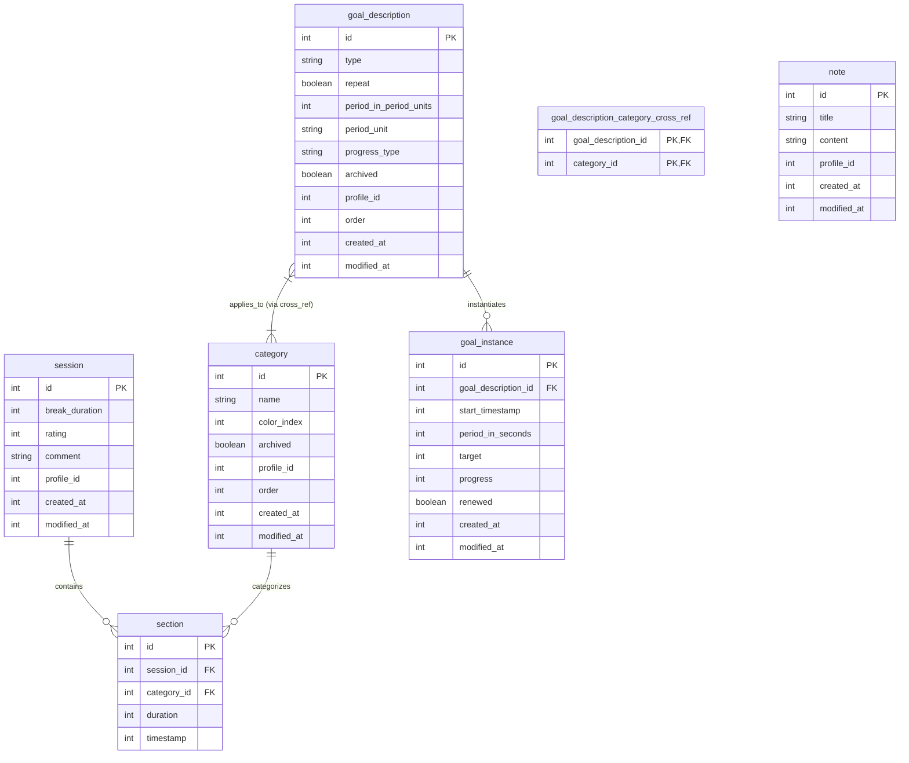

# PracticeTime! Database Documentation

This document provides a comprehensive overview of the local SQLite database schema, entity relationships, Room DAOs, and migration history for **PracticeTime!**.

---

## 1. Overview & Architecture

PracticeTime! relies on an offline-first **Room Database 2.6.1** named `PTDatabase` (current version: **3**).

### Entity Inheritance & Superclasses

All entity classes inherit from a common base hierarchy defined in `PTDao.kt`:

```
BaseModel (id: Long = 0)
   └── ModelWithTimestamps (createdAt: Long, modifiedAt: Long)
          ├── Category
          ├── GoalDescription
          ├── GoalInstance
          ├── Session
          └── Note
```

- **`BaseModel`**: Declares `@PrimaryKey(autoGenerate = true) var id: Long = 0`.
- **`ModelWithTimestamps`**: Adds `created_at` and `modified_at` timestamps (defaulting to current Unix timestamp in seconds).
- **`Section`**: Inherits directly from `BaseModel` (does not track timestamps).
- **`GoalDescriptionCategoryCrossRef`**: Junction entity (composite primary key `[goal_description_id, category_id]`).

> [!CRITICAL]
> **Entity Copying Warning (`.copy()` Anti-Pattern)**:
> In Kotlin, the compiler-generated `copy()` function for a `data class` **only** copies properties declared in its primary constructor. Because `id`, `createdAt`, and `modifiedAt` are declared in superclasses (`BaseModel` / `ModelWithTimestamps`), calling `entity.copy(...)` will call the superclass constructor and reset `id` to `0`. When Room executes `@Update`, it performs `UPDATE table SET ... WHERE id = 0`, matching 0 rows.
> **Rule**: Never use `.copy()` to update an existing Room entity. Mutate its fields directly (`entity.title = newTitle`) before passing it to `dao.update(entity)`.

---

## 2. Entity Specifications

### `session`
Represents a practice session containing one or more sections.
- **Table**: `session`
- **Columns**:
  - `id` (`INTEGER`, Primary Key, Auto-Increment)
  - `break_duration` (`INTEGER`, NOT NULL): Duration of breaks in seconds.
  - `rating` (`INTEGER`, NOT NULL): User rating (1 to 5).
  - `comment` (`TEXT`, Nullable): Optional session notes.
  - `profile_id` (`INTEGER`, NOT NULL, Index): Multi-profile support (currently `0`).
  - `created_at` (`INTEGER`, NOT NULL, Default `0`)
  - `modified_at` (`INTEGER`, NOT NULL, Default `0`)

### `section`
Represents a single timed practice segment belonging to a category within a session.
- **Table**: `section`
- **Columns**:
  - `id` (`INTEGER`, Primary Key, Auto-Increment)
  - `session_id` (`INTEGER`, Nullable, Index): Foreign link to `session.id`.
  - `category_id` (`INTEGER`, NOT NULL, Index): Foreign link to `category.id`.
  - `duration` (`INTEGER`, Nullable): Section duration in seconds.
  - `timestamp` (`INTEGER`, NOT NULL): Unix timestamp when the section was recorded.

### `category`
Represents a practice topic (e.g., "Guitar - Scales", "Piano - Chopin").
- **Table**: `category`
- **Columns**:
  - `id` (`INTEGER`, Primary Key, Auto-Increment)
  - `name` (`TEXT`, NOT NULL): Name of the category.
  - `color_index` (`INTEGER`, NOT NULL): Index (0 to 19) mapping to palette color resources (`category_color_1` .. `20`).
  - `archived` (`INTEGER`, NOT NULL): Boolean flag (0 = active, 1 = archived).
  - `profile_id` (`INTEGER`, NOT NULL, Index): Multi-profile support (`0`).
  - `order` (`INTEGER`, NOT NULL, Default `0`): Custom sorting order.
  - `created_at` (`INTEGER`, NOT NULL, Default `0`)
  - `modified_at` (`INTEGER`, NOT NULL, Default `0`)

### `goal_description`
Defines a user goal target and recurrence rules.
- **Table**: `goal_description`
- **Columns**:
  - `id` (`INTEGER`, Primary Key, Auto-Increment)
  - `type` (`TEXT`, NOT NULL): Enum (`NON_SPECIFIC`, `CATEGORY_SPECIFIC`).
  - `repeat` (`INTEGER`, NOT NULL): Boolean flag (0 = one-time goal, 1 = repeating goal).
  - `period_in_period_units` (`INTEGER`, NOT NULL): Duration magnitude (e.g., `1`, `2`).
  - `period_unit` (`TEXT`, NOT NULL): Enum (`DAY`, `WEEK`, `MONTH`).
  - `progress_type` (`TEXT`, NOT NULL): Enum (`TIME`, `SESSION_COUNT`).
  - `archived` (`INTEGER`, NOT NULL): Boolean flag (0 = active, 1 = archived).
  - `profile_id` (`INTEGER`, NOT NULL, Index): Multi-profile support (`0`).
  - `order` (`INTEGER`, NOT NULL, Default `0`): Sorting order.
  - `created_at` (`INTEGER`, NOT NULL, Default `0`)
  - `modified_at` (`INTEGER`, NOT NULL, Default `0`)

### `goal_instance`
Represents a single concrete period instance of a goal being tracked.
- **Table**: `goal_instance`
- **Columns**:
  - `id` (`INTEGER`, Primary Key, Auto-Increment)
  - `goal_description_id` (`INTEGER`, NOT NULL): Foreign link to `goal_description.id`.
  - `start_timestamp` (`INTEGER`, NOT NULL): Period start timestamp in seconds.
  - `period_in_seconds` (`INTEGER`, NOT NULL): Total period duration in seconds.
  - `target` (`INTEGER`, NOT NULL): Target quantity (seconds or session count).
  - `progress` (`INTEGER`, NOT NULL): Current progress quantity.
  - `renewed` (`INTEGER`, NOT NULL): Boolean flag indicating if renewed for next period.
  - `created_at` (`INTEGER`, NOT NULL, Default `0`)
  - `modified_at` (`INTEGER`, NOT NULL, Default `0`)

### `goal_description_category_cross_ref`
Junction table mapping goals to categories for `CATEGORY_SPECIFIC` goals.
- **Table**: `goal_description_category_cross_ref`
- **Primary Keys**: `(goal_description_id, category_id)`
- **Columns**:
  - `goal_description_id` (`INTEGER`, NOT NULL, Index)
  - `category_id` (`INTEGER`, NOT NULL, Index)

### `note`
Stores user notes.
- **Table**: `note`
- **Columns**:
  - `id` (`INTEGER`, Primary Key, Auto-Increment)
  - `title` (`TEXT`, NOT NULL): Note title (max 100 chars).
  - `content` (`TEXT`, NOT NULL): Note content (max 5000 chars).
  - `profile_id` (`INTEGER`, NOT NULL, Index): Multi-profile support (`0`).
  - `created_at` (`INTEGER`, NOT NULL, Default `0`)
  - `modified_at` (`INTEGER`, NOT NULL, Default `0`)

---

## 3. Entity Relationships Diagram (ERD)



---

## 4. Relation Data Wrappers (`Relations.kt`)

Room relation objects facilitate JOIN queries without manual mapping:

- **`SessionWithSections`**: Embeds `Session` and populates `List<Section>`.
- **`SessionWithSectionsWithCategories`**: Embeds `Session` and populates `List<SectionWithCategory>`.
- **`GoalDescriptionWithCategories`**: Many-to-many relationship mapping a `GoalDescription` to `List<Category>` via `GoalDescriptionCategoryCrossRef`.
- **`CategoryWithGoalDescriptions`**: Inverse many-to-many relationship mapping `Category` to `List<GoalDescription>`.
- **`GoalInstanceWithDescription`**: Embeds `GoalInstance` and fetches its parent `GoalDescription`.
- **`GoalInstanceWithDescriptionWithCategories`**: Embeds `GoalInstance`, `GoalDescription`, and `List<Category>`.

---

## 5. Migration History

### Migration 1 -> 2 (`PTDatabaseMigrationOneToTwo`)
- Migrated tables from legacy names (`PracticeSession` -> `session`, `PracticeSection` -> `section`, `GoalDescription` -> `goal_description`).
- Created `goal_description_category_cross_ref` junction table.
- Converted `oneTime` field to `repeat` boolean logic.
- Added `created_at` and `modified_at` columns to existing entities and populated initial timestamps.

### Migration 2 -> 3 (`PTDatabaseMigrationTwoToThree`)
- Added `note` table:
  ```sql
  CREATE TABLE IF NOT EXISTS `note` (
      `title` TEXT NOT NULL,
      `content` TEXT NOT NULL,
      `profile_id` INTEGER NOT NULL,
      `created_at` INTEGER NOT NULL DEFAULT 0,
      `modified_at` INTEGER NOT NULL DEFAULT 0,
      `id` INTEGER PRIMARY KEY AUTOINCREMENT NOT NULL
  );
  CREATE INDEX IF NOT EXISTS `index_note_profile_id` ON `note` (`profile_id`);
  ```

---

## 6. Accessors & DAO Usage

All DAOs extend `BaseDao<T>` which provides generic `insert()`, `update()`, `delete()`, and `get()` functions.
Static DAO references are accessible globally via the application context:

```kotlin
PracticeTime.sessionDao
PracticeTime.sectionDao
PracticeTime.categoryDao
PracticeTime.goalDescriptionDao
PracticeTime.goalInstanceDao
PracticeTime.noteDao
```

All DAO operations must be called from coroutine scopes (e.g. `lifecycleScope.launch`) as they are marked as `suspend` functions.
